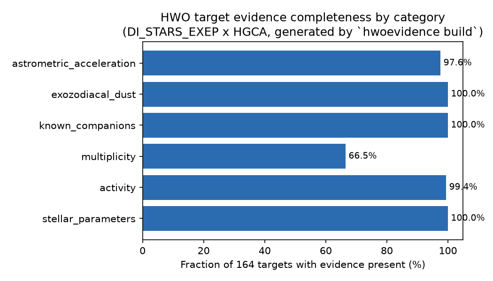

# HWO Target Evidence Cross-Match

[](https://github.com/Biswajit1999/hwo-target-evidence-atlas/actions/workflows/ci.yml)
[](LICENSE)

Which candidate Habitable Worlds Observatory (HWO) direct-imaging targets
have sufficiently complete pre-launch evidence -- stellar parameters,
activity, multiplicity, known companions, exozodiacal dust, and astrometric
acceleration -- and where do independent catalogs disagree about that
evidence?

This project cross-matches the NASA Exoplanet Archive's 164-target Direct
Imaging ExEP Mission Star List (Mamajek & Stapelfeldt 2024) against the
Hipparcos-Gaia Catalog of Accelerations (Brandt 2021) and reports, per
star and per evidence category, whether the relevant measurement exists at
all. It does not rank targets by a single combined score -- see
`docs/METHODS.md` for why that distinction matters.

## Quickstart

```bash
git clone https://github.com/Biswajit1999/hwo-target-evidence-atlas.git
cd hwo-target-evidence-atlas
python -m pip install -e ".[dev]"

pytest -q                                   # 18 fast tests, fixture-based, no network
hwoevidence build --out results/
```

See `docs/REPRODUCIBILITY.md` for full detail.

## Result



Across the 164 targets (`results/evidence_matrix.csv`, generated by
`hwoevidence build`): stellar-parameter, known-companion, and
exozodiacal-dust-flag evidence are essentially complete (100%, 100%,
100%), chromospheric-activity evidence is 99.4% complete, HGCA
astrometric-acceleration entries exist for 97.6%, and multiplicity
evidence (a Washington Double Star catalog cross-match) exists for only
66.5% -- the clearest, most actionable gap in this list.

**31 of 164 targets** show a statistically significant (p < 0.01) HGCA
astrometric acceleration with **no companion flagged** in the archive's
own known-companion list (`results/conflicts.csv`) -- candidates for
follow-up, not confirmed companions; see `docs/METHODS.md` and
`docs/LIMITATIONS.md` for exactly what this does and does not establish.

## What this is not

- Not a claim that any specific star does or does not host a planet,
  companion, or exozodiacal dust beyond what the cited catalogs directly
  report.
- Not an official Habitable Worlds Observatory, ExEP, or NASA Exoplanet
  Archive product; not affiliated with or endorsed by NASA, STScI, JPL, or
  the ExEP program.
- Not a target-selection recommendation -- mission target selection is a
  decision this project has no role in.

## Repository layout

```
src/hwoevidence/   catalog adapters, evidence matrix, conflict detection, ranking
tests/             fixture-based + live-network tests
docs/              METHODS, DATA_SOURCES, LIMITATIONS, REPRODUCIBILITY, VALIDATION, CLAIMS
results/           generated outputs only (see results/README.md)
```

## Citation

See `CITATION.cff`. This project builds on and cites Mamajek & Stapelfeldt
(2024, ApJS 272, 32) and Brandt (2021, ApJS 254, 42).

## Contributing

See `CONTRIBUTING.md`.

## Acknowledgments

See `ACKNOWLEDGMENTS.md`.
