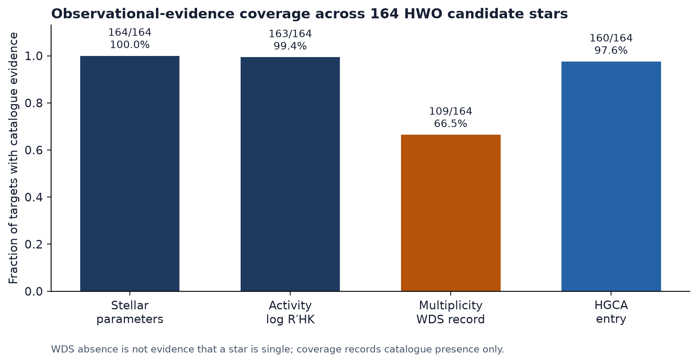
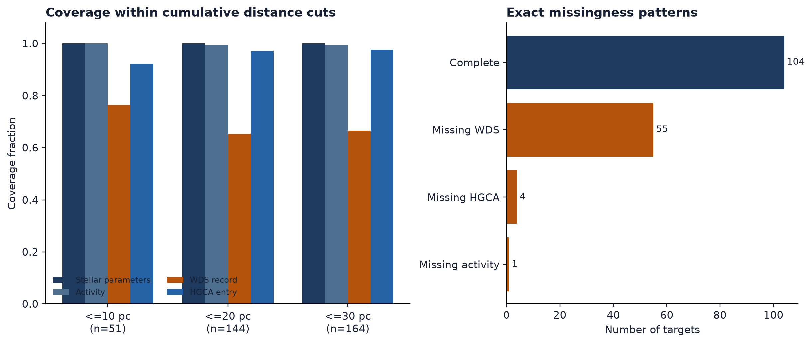
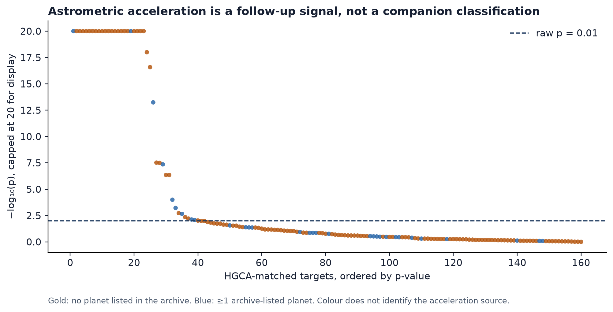

# HWO Target Evidence Cross-Match

[](https://github.com/Biswajit1999/hwo-target-evidence-atlas/actions/workflows/ci.yml)
[](LICENSE)

Which candidate Habitable Worlds Observatory (HWO) direct-imaging targets
have complete pre-launch **observational coverage** -- stellar parameters,
chromospheric activity, multiplicity (WDS), and HGCA astrometric
acceleration -- and for which stars is a significant HGCA acceleration not
matched by an archive-listed planet?

This project cross-matches the NASA Exoplanet Archive's 164-target Direct
Imaging ExEP Mission Star List (Mamajek & Stapelfeldt 2024) against the
Hipparcos-Gaia Catalog of Accelerations (Brandt 2021) and reports, per
star and per category, whether a real measurement exists. Two archive
fields (known-planet flag, circumstellar-disk flag) are tracked separately
and deliberately **excluded** from the completeness score: they are
populated for essentially every row in this list regardless of whether any
actual companion or exozodi observation was ever made, so including them
would silently inflate every star's score by a fixed, uninformative amount
-- see `docs/LIMITATIONS.md`. This project does not rank targets by a
single combined score -- see `docs/METHODS.md` for why that distinction
matters.

## Quickstart

```bash
git clone https://github.com/Biswajit1999/hwo-target-evidence-atlas.git
cd hwo-target-evidence-atlas
python -m pip install -e ".[dev]"

pytest -q                                   # 29 fast tests, fixture-based, no network
hwoevidence build --out results/
python scripts/make_figures.py              # regenerate results/figures/
```

See `docs/REPRODUCIBILITY.md` for full detail.

## Result



Across the 164 targets (`results/evidence_matrix.csv`, generated by
`hwoevidence build`, one row per target -- `target_id` is a deterministic
composite-identity key, invariant to source row order; several targets share a Hipparcos number with a wide-binary
companion, so `hip_name`/`hip_number` are not unique row keys): real
observational coverage is 100% for stellar parameters, 99.4% for
chromospheric activity, 97.6% for HGCA astrometric-acceleration entries,
and only 66.5% for multiplicity (a Washington Double Star catalog
cross-match) -- the clearest, most actionable gap in this list. Mean
`evidence_completeness` across these four real coverage categories is
90.9%. (The known-planet-flag and circumstellar-disk-flag archive fields
are separately 100% populated for every target -- shown in gray in the
figure -- but this reflects the archive's bookkeeping, not real companion
or exozodi surveys; see `docs/LIMITATIONS.md`.)

**31 of 164 targets** (28 after Benjamini-Hochberg false-discovery-rate
correction across the 160 non-null HGCA tests, `hgca_significant_accel_fdr` in
`results/evidence_matrix.csv`) show a statistically significant (p < 0.01)
HGCA astrometric acceleration alongside **no archive-listed planet**
(`results/hgca_accelerators_without_listed_planets.csv`). This is **not**
a catalog disagreement or a confirmed companion: `sy_planets_flag == "N"`
means no archive-listed planet, not a confirmed single-star determination
-- the acceleration could come from a stellar, brown-dwarf, or
planetary-mass companion the archive simply hasn't listed as a planet. See
`docs/METHODS.md` and `docs/LIMITATIONS.md` for exactly what this does and
does not establish.

The exact missingness analysis finds 104 targets with all four categories,
55 missing only a WDS record, four missing only an HGCA entry, and one
missing only the activity measurement.



The gap is not erased by restricting the sample to nearby stars: WDS-record
coverage is 76.5% within 10 pc (39/51) and 65.3% within 20 pc (94/144).
These are catalogue-presence fractions, not statements that targets without
a WDS entry are single.



## What this is not

- Not a claim that any specific star does or does not host a planet,
  companion, or exozodiacal dust beyond what the cited catalogs directly
  report.
- Not an official Habitable Worlds Observatory, ExEP, or NASA Exoplanet
  Archive product; not affiliated with or endorsed by NASA, STScI, JPL, or
  the ExEP program.
- Not a target-selection recommendation -- mission target selection is a
  decision this project has no role in.

## Repository layout

```
src/hwoevidence/   catalog adapters, evidence matrix, conflict detection, ranking
tests/             fixture-based + live-network tests
docs/              METHODS, DATA_SOURCES, LIMITATIONS, REPRODUCIBILITY, VALIDATION, CLAIMS
results/           generated outputs only (see results/README.md)
```

## Citation

See `CITATION.cff`. This project builds on and cites Mamajek & Stapelfeldt
(2024, ApJS 272, 32) and Brandt (2021, ApJS 254, 42).

## Contributing

See `CONTRIBUTING.md`.

## Acknowledgments

See `ACKNOWLEDGMENTS.md`.
